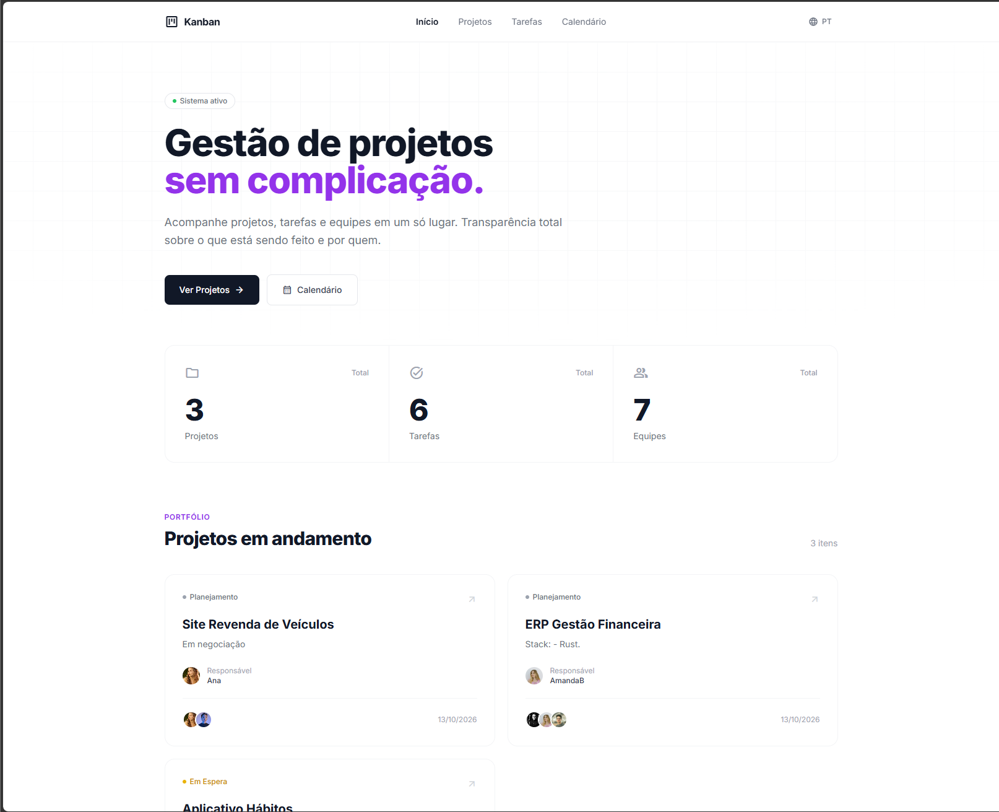

<div align="center">

# Kanban

**Sistema minimalista de gestão de projetos, tarefas e equipes.**

[](https://www.djangoproject.com/)
[](https://www.python.org/)
[](https://unfoldadmin.com/)
[](https://tailwindcss.com/)
[](#-licença)



</div>

---

## Sobre o projeto

**Kanban** é um sistema web completo para gerenciamento de projetos, tarefas e equipes, construído com Django + Unfold + TailwindCSS. Foi projetado para ser simples, direto e com uma interface limpa tanto no painel administrativo quanto no site público.

O projeto é **código aberto** e pode ser usado, estudado e modificado livremente, **desde que não seja comercializado**. Veja a seção [Licença](#-licença) para mais detalhes.

## Funcionalidades

### Painel administrativo (Unfold)
- Dashboard com KPIs e gráficos
- Gerenciamento de Projetos, Tarefas e Equipes
- Perfis de usuários com avatar
- Histórico de atividades unificado (timeline)
- Múltiplos idiomas (pt-br, en, es, de, it)
- Site dropdown personalizado
- Tema claro/escuro

### Site público
- Landing page minimalista com hero
- Estatísticas colapsáveis (doughnut, radar, polar area, line)
- Detalhes do projeto com timeline de atividades
- Lista de tarefas com filtros por status e prioridade
- Calendário interativo (FullCalendar) com eventos
- Design responsivo e multilíngue
- JS ofuscado (proteção do código servido)

### Modelos principais
- `Team` — Equipes com membros e avatar
- `Project` — Projetos com múltiplas equipes e responsável
- `Task` — Tarefas com prioridade, status e prazo
- `UserProfile` — Avatar do usuário
- `Activity` — Histórico unificado (equipes, membros, tarefas)

## Stack

| Camada | Tecnologia |
|--------|-----------|
| Backend | Django 5.1.4 |
| Admin | django-unfold |
| Banco | MySQL (mysqlclient) |
| Frontend | TailwindCSS (CDN) + Alpine.js |
| Gráficos | Chart.js |
| Calendário | FullCalendar |
| Ofuscação JS | javascript-obfuscator |
| Tradução | gettext |

## Pré-requisitos

- Python 3.12+
- MySQL 8.0+
- Node.js (apenas para recompilar o JS ofuscado)
- gettext (para gerar traduções)

## Instalação

### 1. Clone o repositório

```bash
git clone https://github.com/seu-usuario/kanban.git
cd kanban
```

### 2. Crie o ambiente virtual

```powershell
python -m venv .venv
.\.venv\Scripts\Activate.ps1
```

### 3. Instale as dependências

```powershell
pip install -r requirements.txt
```

### 4. Configure o banco de dados

Crie o banco `DB_KANBAN` no MySQL e o arquivo `.env` na raiz:

```env
SECRET_KEY=sua-chave-secreta
DEBUG=True
ALLOWED_HOSTS=*
DB_ENGINE=django.db.backends.mysql
DB_NAME=DB_KANBAN
DB_USER=root
DB_PASSWORD=
DB_HOST=127.0.0.1
DB_PORT=3306
```

### 5. Rode as migrações

```powershell
python manage.py makemigrations
python manage.py migrate
python manage.py createsuperuser
```

### 6. Rode o servidor

```powershell
python manage.py runserver
```

Acesse:
- Site público: `http://127.0.0.1:8000/pt-br/`
- Admin: `http://127.0.0.1:8000/admin/`

## Compilando traduções

```powershell
python manage.py makemessages -l en -l es -l de -l it
python manage.py compilemessages
```

> Windows: requer GNU gettext instalado ([download](https://mlocati.github.io/articles/gettext-iconv-windows.html)).

## Ofuscando o JavaScript

O JS público fica em `static_src/js/` e é ofuscado para `static/js/`:

```powershell
npm install -g javascript-obfuscator
.\ofuscar.ps1
```

## Estrutura do projeto

```
kanban/
├── core/                  # Configurações Django
├── projects/              # App principal
│   ├── migrations/
│   ├── admin.py
│   ├── models.py
│   ├── signals.py         # Histórico de atividades
│   ├── urls.py
│   └── views.py
├── locale/                # Traduções (pt-br, en, es, de, it)
├── templates/
│   ├── admin/             # Customização Unfold
│   └── public/            # Site público
├── static_src/js/         # JS fonte (antes de ofuscar)
├── static/js/             # JS ofuscado (servido)
├── media/                 # Uploads (avatars)
├── ofuscar.ps1            # Script de ofuscação
├── manage.py
└── requirements.txt
```

## Idiomas suportados

- 🇧🇷 Português (Brasil)
- 🇺🇸 Inglês
- 🇪🇸 Espanhol
- 🇩🇪 Alemão
- 🇮🇹 Italiano

## Licença

Este projeto é **open source** e pode ser:

- ✅ Usado livremente para fins pessoais, educacionais ou internos
- ✅ Estudado, modificado e redistribuído
- ✅ Compartilhado com a comunidade

**Não é permitido:**

- ❌ Comercializar o software (venda, revenda ou inclusão em produto pago)
- ❌ Cobrar pelo acesso ao sistema ou por sua distribuição

Para uso comercial, entre em contato previamente.

Este projeto é fornecido "como está", sem garantias de qualquer tipo.

---

<div align="center">

Feito com Django + Unfold + TailwindCSS

</div>